# TeamBoard Knowledge Base API

A Django REST Framework backend for TeamBoard, a B2B API service. Companies
register to receive credentials, query a curated technical knowledge base by
keyword, and every query is logged. A platform admin can view live usage
statistics.

## Features

- Company registration with an automatically generated API key and JWT access token
- JWT-protected knowledge base search across questions and answers (case-insensitive)
- Atomic query logging, including queries that return no results
- Admin-only usage dashboard: total queries, active companies, top search terms
- Role-based access control (`admin` / `client`)

## Tech Stack

- Python 3.12, Django 5.0
- Django REST Framework 3.15
- djangorestframework-simplejwt (JWT authentication)
- PostgreSQL 16 (Docker)
- python-dotenv (environment configuration)

## Prerequisites

- Python 3.10 to 3.12
- Docker and Docker Compose
- pip

## Setup

### 1. Clone and install dependencies

```bash
git clone <repository-url>
cd teamboard-backend
python3 -m venv venv
source venv/bin/activate      # Windows: venv\Scripts\activate
pip install -r requirements.txt
```

### 2. Configure environment variables

```bash
cp .env.example .env
```

`.env` holds the Django secret key and all PostgreSQL credentials. It is
excluded from version control. If port `5432` is already in use on your
machine, set `POSTGRES_PORT` in `.env` to a free port (for example `5433`)
before starting the database; both Docker and Django read this value.

### 3. Start PostgreSQL

```bash
docker compose up -d
```

### 4. Apply migrations

```bash
python manage.py migrate
```

### 5. Seed the knowledge base

```bash
python manage.py seed_kb
```

This loads 12 Q&A entries across the API, Database, Cloud, Framework and
General categories. Several entries share keywords (for example
`select_related`, `JWT`, `Q objects`) so a single search can return multiple
results. The command is safe to run more than once.

### 6. Run the server

```bash
python manage.py runserver
```

The API is served at `http://127.0.0.1:8000/`.

### 7. Create a platform admin

Registration always creates a `CLIENT` company; `role` is never accepted from
the request body. To designate a platform admin, register normally and then
update the role in the database:

```sql
UPDATE api_company SET role = 'admin' WHERE company_name = 'Your Company';
```

The role is read from the database on every request, so the admin endpoint
becomes accessible as soon as the row is updated. Log in again to obtain a
fresh token.

## Project Structure

```
teamboard-backend/
├── teamboard/                  # Django project (settings, root urls)
├── api/
│   ├── models.py               # Company, KBEntry, QueryLog
│   ├── signals.py              # Creates Company + api_key on User creation
│   ├── apps.py                 # Connects the signal in AppConfig.ready()
│   ├── serializers.py
│   ├── permissions.py          # Custom IsAdminUser
│   ├── views.py                # The four endpoints
│   ├── urls.py
│   └── management/commands/seed_kb.py
├── screenshots/                # Test evidence referenced below
├── requirements.txt            # Pinned dependencies
├── docker-compose.yml          # PostgreSQL service
├── .env.example
└── TeamBoard_API.postman_collection.json
```

## Authentication

Every endpoint requires a valid JWT access token except registration and
login. Send the token on each request:

```
Authorization: Bearer <access_token>
```

The `api_key` returned at registration is the company's permanent,
server-issued credential, generated once with `secrets.token_urlsafe(32)` by
a `post_save` signal on `User`. The company is always identified from the
authenticated user (`request.user.company`), never from the request body.

## API Reference

### POST /api/auth/register/

Public. Creates a company account.

Request:
```json
{
  "username": "acmecorp",
  "password": "securepass123",
  "company_name": "Acme Corp",
  "email": "dev@acmecorp.com"
}
```

Response `201 Created`:
```json
{
  "username": "acmecorp",
  "company_name": "Acme Corp",
  "api_key": "wBl1pWNudVza4qQLFTKJHV4vJwVC0fBH_WJX9GkFDSA",
  "access": "eyJhbGciOiJIUzI1NiIsInR5cCI6IkpXVCJ9..."
}
```

Response `400 Bad Request` (duplicate username):
```json
{ "username": ["This username is already taken."] }
```

### POST /api/auth/login/

Public. Returns a fresh access token plus the company's credentials.

Request:
```json
{ "username": "acmecorp", "password": "securepass123" }
```

Response `200 OK`:
```json
{
  "access": "eyJhbGciOiJIUzI1NiIsInR5cCI6IkpXVCJ9...",
  "company_name": "Acme Corp",
  "api_key": "wBl1pWNudVza4qQLFTKJHV4vJwVC0fBH_WJX9GkFDSA"
}
```

Response `401 Unauthorized`:
```json
{ "detail": "Invalid username or password." }
```

### POST /api/kb/query/

Protected. Searches question and answer text and logs the query.

Request:
```json
{ "search": "select_related" }
```

Response `200 OK`:
```json
{
  "search": "select_related",
  "count": 2,
  "results": [
    {
      "id": "1",
      "question": "What is select_related in Django ORM?",
      "answer": "select_related performs a SQL JOIN and fetches related objects in the same query, reducing the number of database hits for foreign key and one-to-one relations.",
      "category": "database"
    },
    {
      "id": "2",
      "question": "How does prefetch_related differ from select_related?",
      "answer": "prefetch_related runs a separate query per relation and joins the results in Python, which works for many-to-many and reverse foreign key relations where a single SQL JOIN is not possible.",
      "category": "database"
    }
  ]
}
```

The search and the `QueryLog` insert run inside a single `transaction.atomic()`
block. A search with no matches returns `200` with `"count": 0` and an empty
`results` list, and is still logged, because usage is billed per query made
rather than per answer found.

Other responses: `400` when `search` is missing or blank, `401` when no valid
token is supplied.

### GET /api/admin/usage-summary/

Protected, admin only.

Response `200 OK`:
```json
{
  "total_queries": 2,
  "active_companies": 1,
  "top_search_terms": [
    { "search_term": "xyznonexistentterm", "count": 1 },
    { "search_term": "select_related", "count": 1 }
  ]
}
```

Response `403 Forbidden` for a `CLIENT` account:
```json
{ "detail": "Admin privileges are required to access this resource." }
```

## Testing

`TeamBoard_API.postman_collection.json` contains 11 requests, each with
automated assertions on status code and response shape.

| # | Scenario | Expected |
|---|----------|----------|
| 1 | Register, success | 201 |
| 2 | Register, duplicate username | 400 |
| 3 | Login, success | 200 |
| 4 | Login, invalid credentials | 401 |
| 5 | KB query, no token | 401 |
| 6 | KB query, valid search with results | 200 |
| 7 | KB query, blank search | 400 |
| 8 | KB query, missing search field | 400 |
| 9 | KB query, no matches | 200, count 0 |
| 10 | Admin usage summary, client account | 403 |
| 11 | Admin usage summary, admin account | 200 |

To run the collection, import it into Postman and send requests 1 to 10 in
order; requests 1 and 3 store the access token in a collection variable that
later requests use. Scenario 11 requires an admin account: promote the
company as described in setup step 7, send request 3 again, then send
request 11.

## Test Evidence

### Environment and data

PostgreSQL running in Docker:

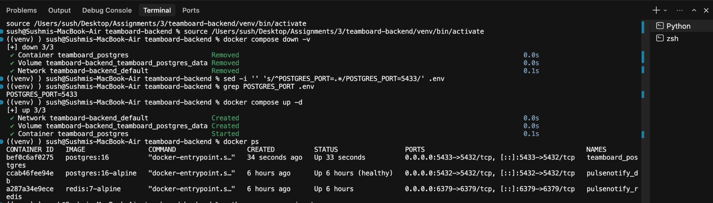

Migrations applied, knowledge base seeded (12 entries), server started:

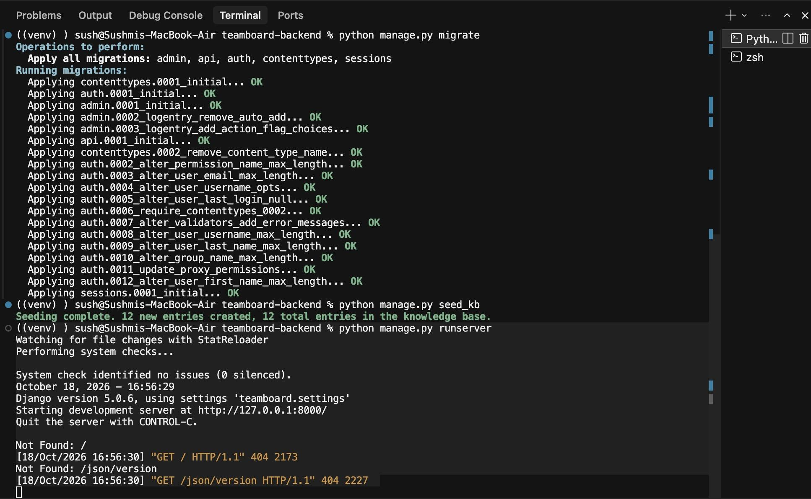

Tables created in PostgreSQL (`api_company`, `api_kbentry`, `api_querylog`):

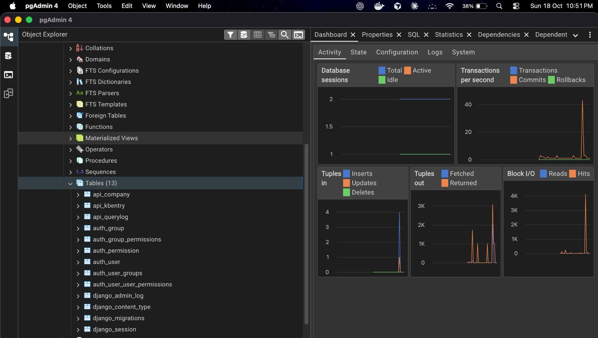

Seeded knowledge base entries:

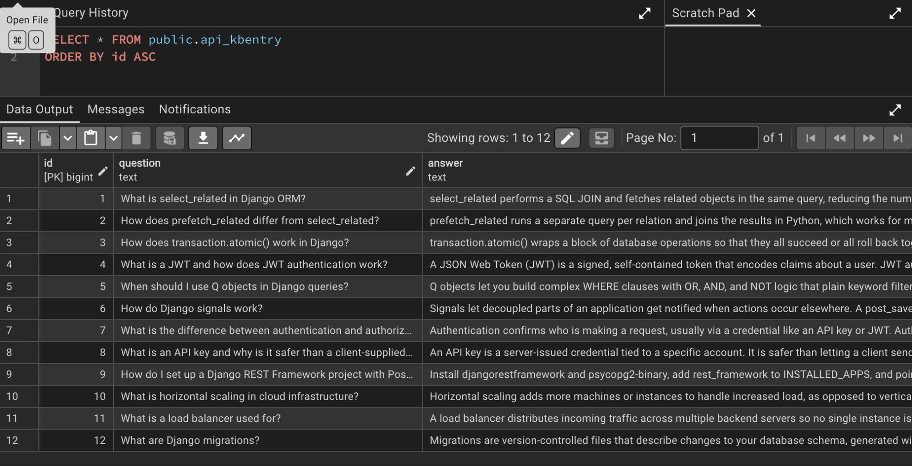

### Authentication (scenarios 1 to 4)

Registration returns 201 with an API key and token, a duplicate username
returns 400, login returns 200, and invalid credentials return 401:

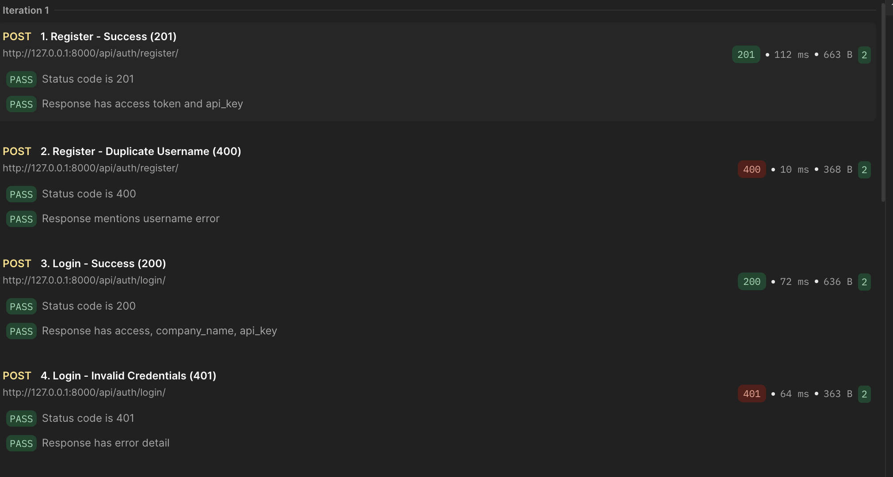

The `Company` row, including the generated `api_key` and the default
`client` role, was created by the signal rather than by the view:

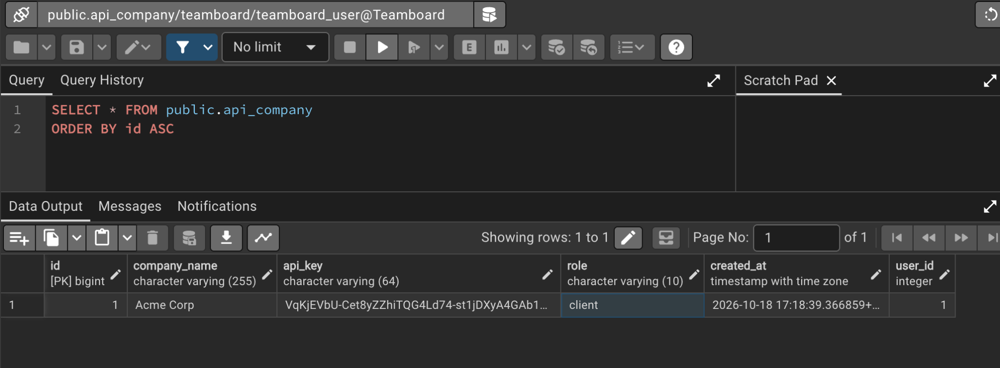

### Knowledge base query (scenarios 5 to 9)

No token returns 401, a valid search returns 200 with matching results, and
blank or missing search values return 400:

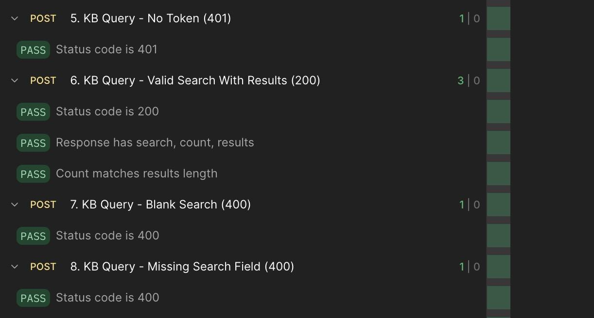

A search with no matches returns 200 with `count` 0. The same screenshot
shows the client account receiving 403 on the admin endpoint (scenario 10):

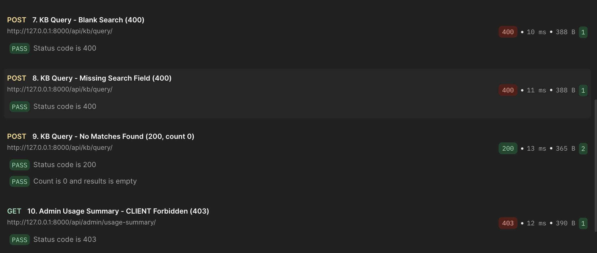

Every query is persisted in `QueryLog`, including the zero-result search
(`results_count` 0):

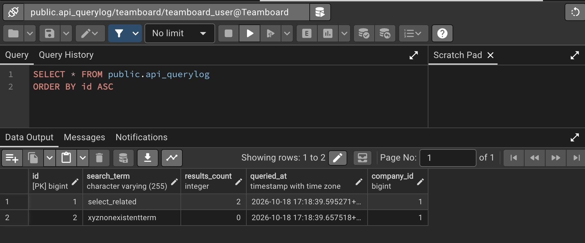

### Admin usage summary (scenarios 10 and 11)

After the company's role is set to `admin`:

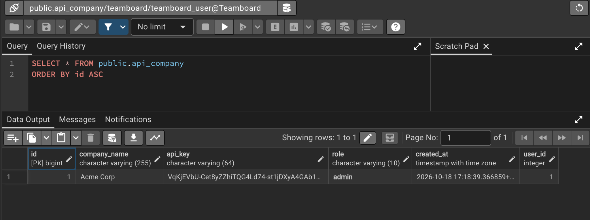

The admin account then receives 200 with the aggregated statistics, which
match the two rows in `QueryLog` (two queries, one active company, two
distinct search terms):

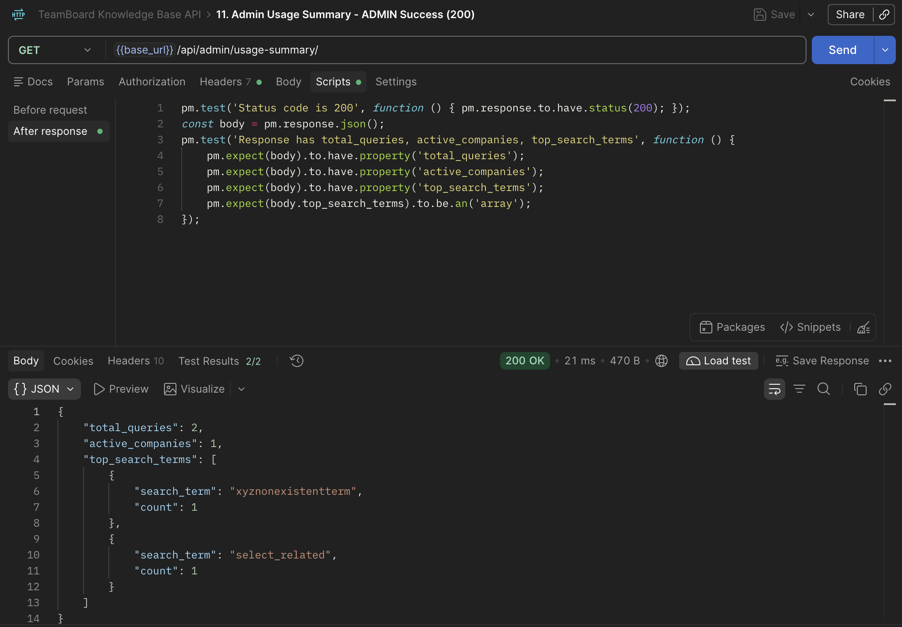

## Requirements Coverage

| Requirement | Implementation |
|-------------|----------------|
| Four endpoints: register, login, KB query, admin usage summary | `api/views.py`, routed in `api/urls.py` |
| Register and login public, all else protected by default | Global `JWTAuthentication` + `IsAuthenticated`; the two public views set `authentication_classes = []` and `permission_classes = []` |
| Unique API key generated automatically on registration | `post_save` signal in `api/signals.py` using `secrets.token_urlsafe(32)`, connected in `AppConfig.ready()` |
| `role` always defaults to `CLIENT` | Never read from the request; set by the model default |
| JWT returned on register and login | SimpleJWT access token in both responses |
| Duplicate username returns 400, bad credentials return 401 | Serializer validation; `authenticate()` check in login |
| Company taken from the token, not the request body | `request.user.company` in the query view |
| Case-insensitive search on question and answer with `Q` objects | `icontains` on both fields |
| Search and log written atomically | `transaction.atomic()` around the search and `QueryLog` create |
| Zero-result searches return 200 and are still logged | Verified in scenario 9 and the `api_querylog` screenshot |
| Blank or missing `search` returns 400, no token returns 401 | Scenarios 5, 7 and 8 |
| Admin-only access via custom permission, not `is_staff` | `IsAdminUser` in `api/permissions.py` checks `company.role` |
| Usage statistics via `aggregate()` and grouped `annotate()` | `UsageSummaryView` in `api/views.py` |
| PostgreSQL in Docker, credentials in `.env` | `docker-compose.yml`, `.env.example`, `.gitignore` |
| Pinned `requirements.txt` | Django, DRF, SimpleJWT, psycopg2-binary, python-dotenv |
| At least 10 seeded KB entries across categories | `seed_kb` creates 12 entries across 5 categories |
| Postman collection covering all 11 scenarios | `TeamBoard_API.postman_collection.json` |

All eleven scenarios in the brief behave as specified. The screenshots above
show each of them returning the expected status code and payload against a
live PostgreSQL database.
